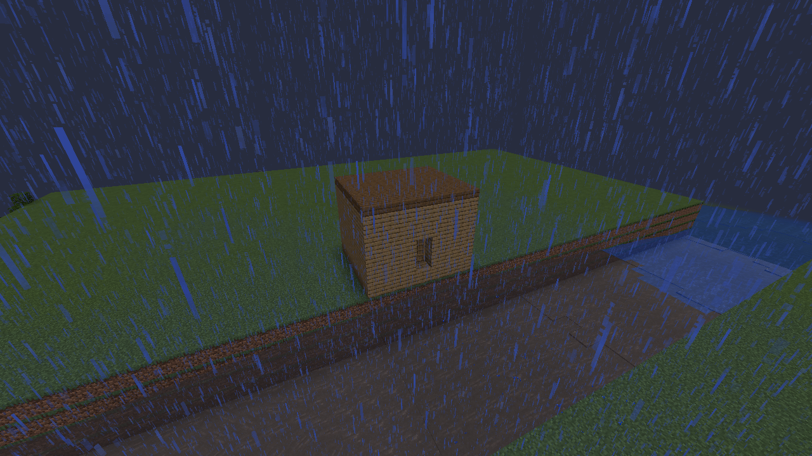

# 🌊 Powódź – datapack do Minecraft 1.21+

Woda stopniowo podnosi się w całym świecie (wokół wszystkich graczy w Overworldzie), towarzyszy jej burza.

## Instalacja
1. Pobierz `powodz.zip` (albo skopiuj folder `powodz`).
2. Wrzuć do `.minecraft/saves/<twój_świat>/datapacks/`.
3. W grze wpisz `/reload` (potrzebne cheaty / uprawnienia OP).

## Komendy
| Komenda | Działanie |
|---|---|
| `/function powodz:start` | start powodzi od poziomu Twoich stóp |
| `/function powodz:auto` | **tryb pogodowy** – włącz/wyłącz (patrz niżej) |
| `/function powodz:stop` | zatrzymanie podnoszenia wody |
| `/function powodz:wznow` | wznowienie od obecnego poziomu |
| `/function powodz:szybciej` / `wolniej` | 2× szybciej / wolniej |
| `/function powodz:osusz` | usuwa wodę powodziową wokół Ciebie |
| `/function powodz:reset` | ustawienia domyślne |
| `/function powodz:pomoc` | lista komend w grze |

## 🌧 Tryb pogodowy (`/function powodz:auto`)
Powódź zależy od pogody (poziom bazowy = Twoje Y w chwili włączenia):
- **deszcz** – woda rośnie o 1 blok co `#predkosc` ticków,
- **burza** – woda rośnie 2× szybciej,
- **brak opadów** – woda powoli opada, aż wróci do poziomu bazowego.

Pogodę można wymusić: `/weather rain`, `/weather thunder`, `/weather clear`.
Woda opada tylko w promieniu `#promien` od graczy – w dalszych, niewczytanych miejscach może zostać.

## Ustawienia
`/scoreboard players set <nazwa> powodz <wartość>`

| Nazwa | Domyślnie | Opis |
|---|---|---|
| `#predkosc` | 200 | co ile ticków woda rośnie o 1 blok (20 = 1 s) |
| `#max` | 200 | maksymalny poziom wody (Y) |
| `#promien` | 32 | promień zalewania wokół gracza (max 48) |
| `#poziom` | – | obecny poziom wody (można zmienić ręcznie) |

## Jak to działa
Co `#predkosc` ticków poziom rośnie o 1, a co 2 sekundy datapack wypełnia wodą powietrze, trawę, kwiaty itp.
w kwadracie wokół każdego gracza (3 najwyższe warstwy powodzi). Dzięki temu woda pojawia się też tam,
gdzie gracz dopiero dojdzie. Bloki stałe nie są niszczone.

---

# 🌧 Mod „Powódź” (Fabric, Minecraft 1.21.1) – prawdziwa fizyka wody

Plik: `powodz-mod-1.1.0-mc1.21.1.jar` (kod w `powodz-mod/`).

## Instalacja
1. Zainstaluj [Fabric Loader](https://fabricmc.net/use/) dla **1.21.1**.
2. Do `.minecraft/mods/` wrzuć `powodz-mod-1.1.0-mc1.21.1.jar` oraz **Fabric API** (dla 1.21.1).

## Co robi
- **Woda jest skończona** – ma 8 warstw (po 1/8 bloku = „piksele”). Nie tworzy się z niczego; spływa w dół i wyrównuje się na boki.
- **Deszcz** dolewa po 1/8 bloku w losowych miejscach wokół graczy (w każdym biomie, gdzie pada), **burza 3× więcej**.
- **Słońce** – cienkie warstwy powoli parują (morza i jeziora zostają).
- **Kanały** – woda sama szuka spadku do 6 bloków i spływa do rowów.
- **Odpływ** (nowy blok) – połyka wodę, która na niego spłynie. Postaw go na dnie kanału.
  Crafting: kraty żelazne w rogach + lej na środku → 2 odpływy.

- **Błotnista rzeka** – podczas burzy woda w biomach rzek robi się brązowa (mod musi być też u gracza).
- **Erozja (tylko przy rzekach)** – podczas burzy woda wypłukuje brzegi (ziemia, piasek, żwir) i porywa
  kawałki domów (deski, drewno, szkło, drzwi, płoty, wełna, pochodnie…). Bloki wypadają jako przedmioty
  i płyną z nurtem rzeki. Kamień, cegły i beton są odporne. Lista bloków: tag `powodz:wymywalne`.

## Komendy (`/powodz`, wymaga OP)
| Komenda | Działanie |
|---|---|
| `/powodz` lub `/powodz pomoc` | lista komend |
| `/powodz status` | obecne ustawienia i pogoda |
| `/powodz burza [sekundy]` | wielka burza: woda rośnie 3×, rzeka brązowa, erozja |
| `/powodz deszcz [sekundy]` | zwykły deszcz |
| `/powodz slonce` | koniec opadów – woda paruje |
| `/powodz sila <krople>` | siła deszczu (domyślnie 8) |
| `/powodz erozja <siła>` / `wylacz` | siła porywania bloków przy rzece (domyślnie 10) |
| `/powodz bloto burza\|zawsze\|nigdy` | kiedy rzeka jest brązowa |
| `/powodz parowanie <ile>` | parowanie przy słońcu (domyślnie 2) |
| `/powodz promien <bloki>` | zasięg deszczu i erozji wokół gracza |
| `/powodz fizyka wlacz\|wylacz` | skończona fizyka wody |
| `/powodz osusz [promień]` | usuwa całą wodę powyżej poziomu morza wokół Ciebie |

## Gamerule
| Gamerule | Domyślnie | Opis |
|---|---|---|
| `powodzFizyka` | true | włącza całą fizykę (false = zwykła woda) |
| `powodzDeszcz` | 8 | krople na tick wokół gracza podczas deszczu (burza = 3×) |
| `powodzParowanie` | 2 | ile miejsc na tick paruje przy ładnej pogodzie (0 = wyłączone) |
| `powodzPromien` | 64 | promień deszczu wokół gracza |
| `powodzErozja` | 10 | siła erozji przy rzekach podczas burzy (0 = wyłączona) |
| `powodzBloto` | 0 | brązowa rzeka: 0 = przy burzy, 1 = zawsze, 2 = nigdy |

⚠ Uwaga: z włączoną fizyką woda z wiadra rozlewa się w cienką kałużę (nie ma nieskończonych źródeł).
